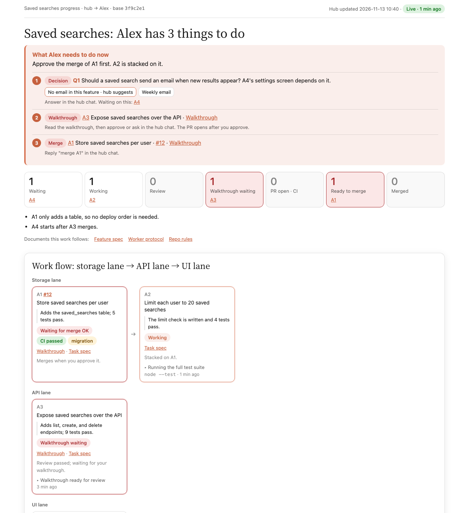

# ddevkim skills

Agent skills shared by ddevkim. More skills may be added; orca-hub is the first.

| Skill | What it does |
|---|---|
| [orca-hub](skills/orca-hub) | Builds a feature you discussed with your agent as small PRs through Orca worker sessions, with an independent review, a walkthrough of each PR, and a live dashboard. |

## orca-hub

### What it does

You discuss a feature with Claude Code or Codex, then invoke orca-hub. Your session becomes the hub: it writes the spec, splits the work into small PRs, and starts one Orca worker per PR in its own worktree. Each worker builds its PR test-first, an independent reviewer checks it, and the hub walks you through the code before the PR opens. A dashboard in an Orca tab shows every PR, its status, and what you need to do next.



### When a hub is worth it

- Use a hub when the work is two or more PRs (more than one outcome, or over the size target of ≤ 15 files / 300 changed lines, counting hand-written code and tests), and at least two of them can run at the same time or stack.
- Skip it for one small PR, or for work that cannot be split into PRs that merge alone. The hub says so and offers to do the work in your session instead.

### Prerequisites

- The Orca app, its `orca` CLI, and its `orchestration` skill
- `git`
- `gh`, logged in
- `node`

The skill installs nothing. It checks these itself before a hub starts, with one command you can also run:

```sh
node <skill folder>/scripts/preflight.cjs
```

It prints one `missing:` line per problem. A missing `orchestration` skill comes with the command that installs it: `orca skills install --skill orchestration`.

### Install

Claude Code:

```sh
claude plugin marketplace add ddevkim/skills
claude plugin install orca-hub@ddevkim-skills
```

Inside a Claude Code session: `/plugin marketplace add ddevkim/skills`, then `/plugin install orca-hub@ddevkim-skills`.

Codex:

```sh
codex plugin marketplace add ddevkim/skills
codex plugin add orca-hub@ddevkim-skills
```

Other agents, with the `skills` CLI:

```sh
npx skills add ddevkim/skills --skill orca-hub
```

### Start a hub

1. In an Orca terminal, discuss the feature with your agent until you agree on what to build.
2. Invoke the skill: `/orca-hub:orca-hub` in Claude Code. In Codex or another agent, ask it to use the orca-hub skill.

Run it from any Orca terminal: Orca's sidebar shows the hub's workspace, or the repo's main workspace when the terminal belongs to none, as one entry named after the feature with every worker beneath it, and the hub gives that workspace its old name back when it closes.

The hub then asks you for:

- confirmation of the spec it wrote from your discussion,
- once, whether to keep its run defaults (the worker agent and model, how many workers run at a time, the PR assignee),
- product decisions it should not guess,
- a walkthrough of each PR before the PR opens,
- approval of each merge,
- permission prompts in worker terminals.

That list is the **Low** autonomy level, the default. Tell the hub at the start or at any time to run at **Medium** (PRs open after the independent review, workers may push, open PRs, and delete files in their worktree without a prompt; you still answer product decisions and approve merges) or **High** (the hub also decides product questions, merges on green CI, and runs the repo's documented deploy steps, stopping only for risky steps such as dropping data, spending money, or changing secrets).

### Language

The dashboard and the walkthrough page show their labels in Korean or English, from `lang` (`"ko"` or `"en"`) in the hub's `state.js`. The skill creates that file in its hub folder, `<workspaces root>/_hub/<feature>/state.js` (by default `$HOME/orca/workspaces/<repo>/_hub/<feature>/`).

### Update

Claude Code (restart the session after):

```sh
claude plugin marketplace update ddevkim-skills
claude plugin update orca-hub@ddevkim-skills
```

Codex:

```sh
codex plugin marketplace upgrade ddevkim-skills
codex plugin add orca-hub@ddevkim-skills
```

npx skills:

```sh
npx skills update orca-hub
```

### Uninstall

Claude Code:

```sh
claude plugin uninstall orca-hub@ddevkim-skills
claude plugin marketplace remove ddevkim-skills
```

Codex:

```sh
codex plugin remove orca-hub@ddevkim-skills
codex plugin marketplace remove ddevkim-skills
```

npx skills:

```sh
npx skills remove orca-hub
```

## License

[MIT](LICENSE)
